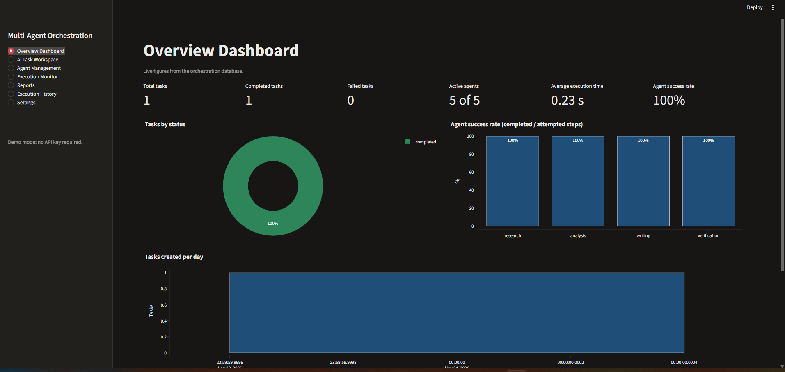
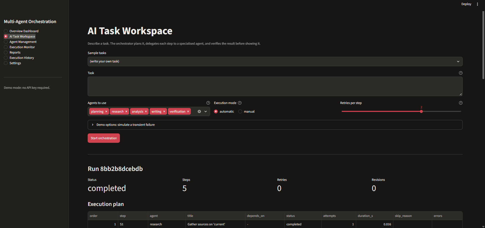
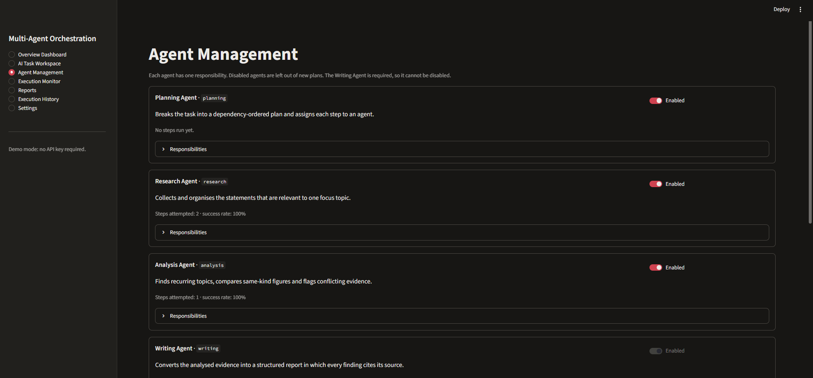
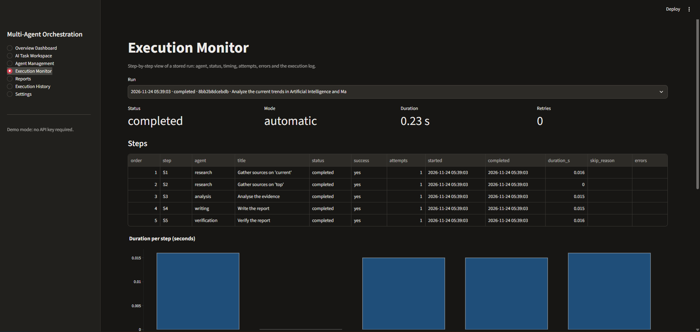
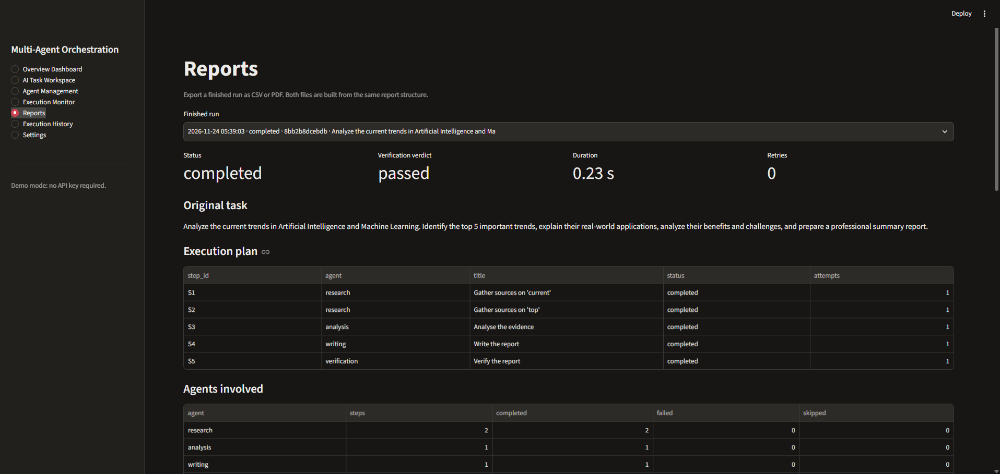
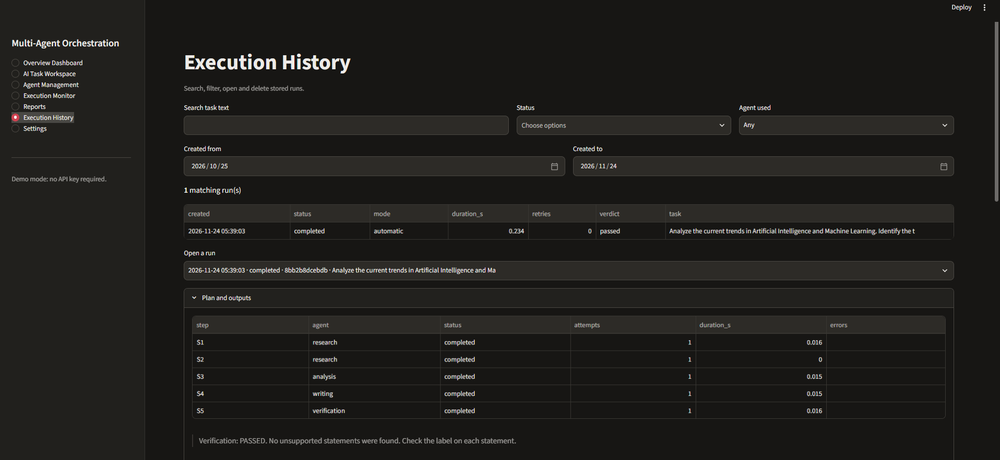
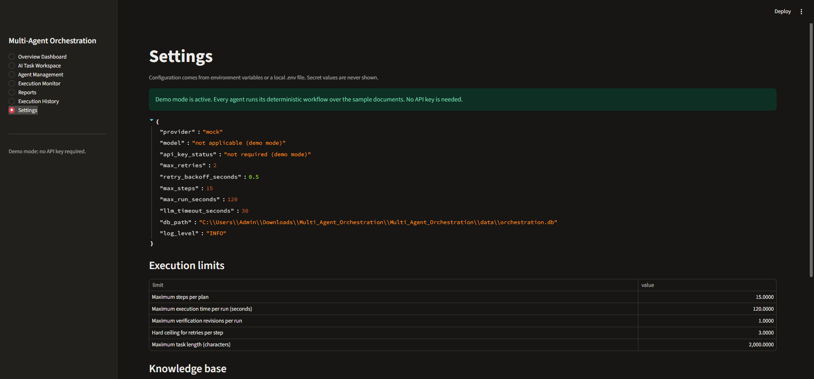

# Multi-Agent Orchestration System

A working multi-agent AI system. You describe a complex task in plain language. A central **orchestrator** asks a **Planning Agent** for a dependency-ordered plan, then delegates each step to one of four specialised agents: **Research**, **Analysis**, **Writing** and **Verification**. Every claim in the final report is checked against the source it cites and labelled as verified, unverified, an inference, or unsupported.

The project runs **fully offline in demo mode**, with no API key and no paid service. Live language-model providers (OpenAI-compatible or Anthropic) can be switched on through environment variables.

---

## Contents

1. [What it does](#what-it-does)
2. [Architecture](#architecture)
3. [Agent responsibilities](#agent-responsibilities)
4. [Orchestration workflow](#orchestration-workflow)
5. [Agent communication](#agent-communication)
6. [Failure handling, retries and limits](#failure-handling-retries-and-limits)
7. [Verification rules](#verification-rules)
8. [Demo mode and live mode](#demo-mode-and-live-mode)
9. [Technology stack](#technology-stack)
10. [Project structure](#project-structure)
11. [Installation on Windows](#installation-on-windows)
12. [VS Code setup](#vs-code-setup)
13. [Running the application](#running-the-application)
14. [The seven dashboard pages](#the-seven-dashboard-pages)
15. [API configuration](#api-configuration)
16. [Reports (PDF and CSV)](#reports-pdf-and-csv)
17. [Security](#security)
18. [Testing](#testing)
19. [Screenshots](#screenshots)
20. [Limitations](#limitations)
21. [Future improvements](#future-improvements)
22. [Troubleshooting](#troubleshooting)
23. [Verification status](#verification-status)

---

## What it does

- **Understands a request.** The task is validated (length, control characters) and screened for prompt-injection phrases. Instruction-like text is flagged and treated as data.
- **Plans it.** The Planning Agent finds the focus topics in the task that the knowledge base can answer, creates one research step per topic, then analysis, writing and verification steps, and records the dependencies between them.
- **Delegates and executes.** The orchestrator runs each step in order, sends the step to exactly one agent, collects the output, and routes handoff messages to the steps that depend on it.
- **Verifies.** The Verification Agent checks completeness, citations, figures and conflicts. Unsupported statements go back to the Writing Agent once for revision.
- **Reports.** The final response shows a verdict banner and a label on every statement. Runs can be exported as CSV or PDF.
- **Remembers.** Every run, plan, agent output, log entry and retry is stored in SQLite and can be searched, filtered, reopened or deleted.

---

## Architecture

```
                 ┌──────────────────────────────────────────────┐
  Streamlit UI   │  7 pages: Overview · Workspace · Agents ·    │
  (app.py, ui/)  │  Monitor · Reports · History · Settings      │
                 └────────────────────┬─────────────────────────┘
                                      │ create_run / next_step / approve
                                      ▼
                 ┌──────────────────────────────────────────────┐
                 │          ORCHESTRATOR (orchestration/engine) │
                 │  validates · plans · delegates · routes      │
                 │  messages · retries · revises · aggregates   │
                 │  logs every event · persists every change    │
                 └───┬──────────┬──────────┬──────────┬─────────┘
          task/handoff│          │          │          │ task/handoff/revision
  messages (bus)      ▼          ▼          ▼          ▼
               ┌─────────┐ ┌──────────┐ ┌─────────┐ ┌──────────────┐
               │Research │ │ Analysis │ │ Writing │ │ Verification │
               │ Agent   │ │  Agent   │ │  Agent  │ │    Agent     │
               └────┬────┘ └────┬─────┘ └────┬────┘ └──────┬───────┘
                    │ statements │ insights   │ draft       │ verdict
                    ▼            ▼            ▼             ▼
               ┌──────────────────────────────────────────────────┐
  Shared       │  TaskContext (blackboard): sources S1…Sn,        │
  context      │  insights, conflicts, draft, verification, final │
               └──────────────────────────────────────────────────┘
                    ▲                                    │
  Planning Agent ───┘ (builds the plan before any step)   │
                                                          ▼
               ┌──────────────────────────────────────────────────┐
  Storage      │ SQLite: tasks · plan_steps · agent_outputs ·     │
               │ execution_logs · agent_config                    │
               └──────────────────────────────────────────────────┘
  Knowledge    sample_data/documents/*.md  (36 cited statements; no web access)
  LLM (live)   services/llm_client.py      (OpenAI-compatible or Anthropic, optional)
```

Key design rules:

1. **Agents never call each other.** An agent receives one step, the shared context and its inbox, and returns one output. The orchestrator decides what happens next.
2. **Agents never write to the database.** Only the orchestrator and the repository do.
3. **Every message is routed.** Task, handoff and revision messages all pass through the `MessageBus`, and each one is kept in the run history.
4. **Nothing is generated by code that the user cannot trace.** Each figure in a report comes from a statement in the knowledge base, and each statement carries a source id.

---

## Agent responsibilities

Each agent is a class with a single `handle(step, context, inbox)` method. Its real work is listed below.

| Agent | Responsibility | How it works in demo mode | Output |
|---|---|---|---|
| **Planning** | Turns the task into a dependency-ordered plan and assigns each step to an agent. | Keeps the task words that appear most specifically in the knowledge base, and any named regions (such as "Europe" or "Asia") in the task. Creates one research step per topic, then analysis, writing and verification. Records the assumptions. | A `Plan` validated by Pydantic. |
| **Research** | Collects the statements relevant to one focus topic. | Searches the 36 sample statements by term overlap, keeps the best 10, and gives each statement a stable id (S1, S2, …). Reports coverage gaps. | Registered sources and a search summary. |
| **Analysis** | Finds recurring topics, compares figures and flags conflicts. | Counts the subject terms that recur across statements. For each region, it reports the highest percentage and the statement it comes from. It reports a conflict only when two statements describe the same region and subject, use the same kind of figure, and disagree. | Insights with citations, and a list of conflicts. |
| **Writing** | Turns the evidence into a structured report in which every finding cites its source. | Writes the six required sections in order. Statements are quoted from the sources with their ids. Recommendations are labelled `[Unverified inference]`. On revision, it removes only the statements that verification rejected. | A Markdown draft. |
| **Verification** | Checks the draft against the evidence and labels every statement. | Confirms that all sections exist, that each statement cites a real source, that each figure appears in the cited text, and that most content words match. Reports conflicts and gaps. Deliberately deterministic, so a model cannot grade its own output. | A verdict, per-statement labels and the final annotated report. |

The Planning Agent always runs first. Its plan is validated before any step executes.

---

## Orchestration workflow

1. **Receive.** `create_run` validates the task length and characters, redacts any secret-looking text, checks the selected agents, and screens for injection phrases. Run options are validated by Pydantic, and the retry count is capped at 3.
2. **Plan.** The Planning Agent produces a plan, which is validated for dependencies, enabled agents, the writing step and the step limit. If planning fails, it is retried within the limit.
3. **Approve (manual mode only).** The run waits until the plan is approved. Steps then run one at a time, or all at once.
4. **Execute.** The orchestrator picks the first step whose dependencies have all resolved. It sends a task message, delivers the handoffs from upstream agents, runs the agent, and records the output, duration, attempts and any errors.
5. **Skip when blocked.** A step is skipped only when none of its upstream steps completed. If some upstream steps failed, the step still runs and the report says what was missing.
6. **Verify and revise.** When verification rejects statements, they are sent back to the Writing Agent once. A second rejection is reported as failed, not retried again.
7. **Finish.** The orchestrator sets the final status and the final response, and persists everything.

Final statuses:

| Status | Meaning |
|---|---|
| `completed` | Every step completed and verification passed with no warnings. |
| `completed_with_warnings` | A report was produced, but a step failed, a step was skipped, verification passed with warnings, or a conflict was found. |
| `failed` | No report could be produced (for example planning failed, the writing step failed, or a time limit was reached). |

---

## Agent communication

Agents communicate **only through the orchestrator**, and the orchestrator uses three message types:

| Type | Sender → recipient | When | Content |
|---|---|---|---|
| `task` | orchestrator → agent | When a step starts | Step title, instruction and focus. |
| `handoff` | agent → dependent agent | When an upstream step completes | Source step, its summary and any warnings. |
| `revision` | verification → writing | When verification rejects statements | The rejected lines. |

Every message is recorded in the run's message history and every handoff appears in the execution log. The shared `TaskContext` carries the full data (sources, insights, draft); messages carry summaries. The **Writing Agent's output shows how many handoffs it received**, which makes the communication visible in the Execution Monitor.

---

## Failure handling, retries and limits

| Limit | Default | Hard ceiling | Where |
|---|---|---|---|
| Retries per step | 2 | 3 | `MAX_RETRIES`, and the run's retry slider |
| Backoff between retries | 0.5 s × attempt number | 10 s | `RETRY_BACKOFF_SECONDS` |
| Steps per plan | 15 | 15 | `MAX_STEPS` |
| Execution time per run | 120 s | — | `MAX_RUN_SECONDS` |
| Verification revisions per run | 1 | 1 | `MAX_REVISIONS` |
| Task length | 10–2000 characters | 2000 | `MIN_TASK_CHARS`, `MAX_TASK_CHARS` |
| Live model call timeout | 30 s | 120 s | `LLM_TIMEOUT_SECONDS` |

Behaviour in practice:

- **Transient failures** (timeouts, rate limits, provider 5xx, injected demo faults) are retried. **Other errors** fail immediately, so a bad input is not retried.
- **Every attempt is recorded**, with its error text. Errors are redacted before storage.
- **A failed step** does not stop the run unless it is the writing step. Downstream steps run with what is available, and the report states what was missing.
- **A time or step limit** stops the run cleanly. Pending steps are marked as skipped, with the reason.
- **Demo fault injection** (AI Task Workspace → Demo options) makes one agent fail a set number of times, so the retry and recovery behaviour can be seen.

---

## Verification rules

For each statement in the draft's Executive summary, Key findings, Analysis and Recommendations sections:

1. **Labelled inference?** If it carries `[Unverified inference]`, it is counted as an inference and is not checked against sources.
2. **Has a citation?** No citation → `unsupported`.
3. **Cites a real source?** An id that does not exist → `unsupported`.
4. **Figures match?** Every number in the statement must appear in the cited source text → otherwise `unsupported`.
5. **Words match?** At least 30% of the statement's content words must appear in the cited text → otherwise `unverified` (a warning).
6. Otherwise → `verified`.

Report-level checks: all six sections must be present (missing → failed); sources that disagree are reported as warnings; a run that found no sources is reported as a warning.

Verdicts: `passed`, `passed_with_warnings`, `failed`. Each statement in the final report is labelled `[VERIFIED]`, `[UNVERIFIED]`, `[UNVERIFIED INFERENCE]` or `[UNSUPPORTED]`.

---

## Demo mode and live mode

| | Demo mode (default) | Live mode |
|---|---|---|
| Needs an API key | **No** | Yes |
| Needs internet | **No** | Yes (for the provider) |
| Planning | Rule-based planner | Language model writes a JSON plan, which Pydantic validates |
| Analysis | Rule-based comparison | Rule-based comparison, plus a model-written narrative |
| Writing | Template-based report from the cited statements | Model-written report, checked by the same verification rules |
| Verification | Deterministic | Deterministic (always) |
| Research | Searches the sample documents | Searches the sample documents |

Demo mode is a complete, deterministic implementation of every agent's workflow. Nothing in it is a canned answer: each report is assembled from the sample statements that the Research Agent actually retrieved. Live mode changes only who writes the text for planning, analysis and writing. Verification stays deterministic in both modes.

Select the mode with `LLM_PROVIDER` in `.env`: `mock` (demo), `openai` or `anthropic`.

---

## Technology stack

| Area | Library |
|---|---|
| Language | Python 3.11+ (tested on 3.12) |
| Data contracts and validation | **Pydantic v2** |
| Dashboard | **Streamlit** |
| Charts | **Plotly** |
| PDF reports | **ReportLab** |
| Persistence | SQLite (Python standard library) |
| Live model calls | Python standard library (`urllib`), so no extra HTTP dependency |
| Tests | **pytest** |

---

## Project structure

```
Multi_Agent_Orchestration/
├── app.py                     Streamlit entry point (run this)
├── requirements.txt           Python dependencies (Pydantic v2 included)
├── pytest.ini                 Test configuration
├── .env.example               Copy to .env and edit (never commit .env)
├── .gitignore
├── README.md
├── config/
│   └── settings.py            Paths, limits, environment-driven settings
├── agents/
│   ├── __init__.py            Agent registry, self-test helper
│   ├── base.py                Base class and JSON helpers
│   ├── prompts.py             Live-mode prompts (not used in demo mode)
│   ├── planning_agent.py      Plans the work
│   ├── research_agent.py      Retrieves cited statements
│   ├── analysis_agent.py      Compares figures, finds conflicts
│   ├── writing_agent.py       Drafts the cited report
│   └── verification_agent.py  Checks and labels every statement
├── orchestration/
│   ├── engine.py              The central orchestrator
│   ├── models.py              Pydantic models (plans, outputs, messages, verdicts)
│   ├── state.py               Runtime state of a run
│   ├── context.py             Shared task context (the blackboard)
│   ├── messages.py            Message bus between agents
│   ├── retry.py               Retry policy with a hard ceiling
│   ├── plan_validator.py      Structural plan checks
│   └── logger.py              Execution log (redacted)
├── database/
│   ├── schema.py              SQLite schema
│   └── repository.py          Queries and updates
├── services/
│   ├── security.py            Validation, injection screening, redaction
│   ├── text_utils.py          Normalisation, keywords, figures
│   ├── document_store.py      Knowledge base index
│   └── llm_client.py          Live OpenAI-compatible and Anthropic clients
├── reports/
│   ├── report_builder.py      One report structure for both formats
│   ├── csv_report.py          CSV export (UTF-8 with BOM for Excel)
│   └── pdf_report.py          PDF export (ReportLab)
├── ui/
│   ├── bootstrap.py           Shared services
│   ├── charts.py              Plotly figures
│   └── pages.py               The seven dashboard pages
├── sample_data/
│   ├── documents/             Six synthetic knowledge-base documents (36 statements)
│   └── sample_tasks.json      Six demo tasks, including a prompt-injection demo
├── tests/                     pytest suite (see Testing)
├── data/                      SQLite database is created here at run time
└── screenshots/               Place your own screenshots here (see Screenshots)
```

---

## Installation on Windows

These steps use **PowerShell**, which is the default terminal in VS Code on Windows.

### 1. Install Python 3.11 or newer

1. Download Python from <https://www.python.org/downloads/windows/>.
2. Run the installer and **tick "Add python.exe to PATH"** on the first screen.
3. Open a new PowerShell window and check:

```powershell
python --version
```

If that fails, use `py --version` instead. Use `py` wherever this guide says `python`, if `py` is the command that works.

### 2. Get the project

1. Unzip `Multi_Agent_Orchestration.zip` to a folder such as `C:\Projects\`. This creates `C:\Projects\Multi_Agent_Orchestration\`.
2. Open PowerShell and move into the folder:

```powershell
cd C:\Projects\Multi_Agent_Orchestration
```

### 3. Create a virtual environment

```powershell
python -m venv .venv
.venv\Scripts\Activate.ps1
```

When the environment is active, the prompt starts with `(.venv)`.

If PowerShell says that running scripts is disabled, allow scripts for your user account once, then activate again:

```powershell
Set-ExecutionPolicy -Scope CurrentUser RemoteSigned
.venv\Scripts\Activate.ps1
```

In Command Prompt instead, use `.venv\Scripts\activate.bat`.

### 4. Install the dependencies

With the environment active:

```powershell
python -m pip install --upgrade pip
pip install -r requirements.txt
```

This installs Pydantic v2, Streamlit, Plotly, ReportLab and pytest. All of them ship Windows wheels, so no compiler is needed.

### 5. Check the installation

```powershell
python -c "import pydantic, streamlit, plotly, reportlab, pytest; print('pydantic', pydantic.VERSION, '| streamlit', streamlit.__version__)"
```

---

## VS Code setup

1. Install **Visual Studio Code** from <https://code.visualstudio.com/>.
2. Open the Extensions view (`Ctrl+Shift+X`) and install **Python** (Microsoft). Install **Pylance** if you like.
3. **File → Open Folder…** and choose `C:\Projects\Multi_Agent_Orchestration`.
4. Press `Ctrl+Shift+P`, type **Python: Select Interpreter**, and choose the entry that points to `.venv`.
5. Open a terminal with **Terminal → New Terminal** (`` Ctrl+` ``). The virtual environment activates automatically when VS Code has selected `.venv`. If it does not, run `.venv\Scripts\Activate.ps1`.
6. To run tests from the editor, open the **Testing** view (flask icon), choose **pytest** and the `tests` folder when prompted. You can also run `python -m pytest -v` in the terminal.

---

## Running the application

From the project folder with the environment active:

```powershell
streamlit run app.py
```

Streamlit prints an address, normally `http://localhost:8501`, and usually opens it in your browser. On first run it may ask for an email address; press `Enter` to skip. Stop the server with `Ctrl+C`.

**No configuration is needed.** The app starts in demo mode with no API key. The database is created automatically in `data\orchestration.db`.

Try it in this order:

1. **Overview Dashboard**: empty at first.
2. **AI Task Workspace**: pick **EV brief: Europe vs Asia** from the sample tasks and press **Start orchestration**. Watch the progress bar, then read the verified report and download the CSV or PDF.
3. Pick **Consumer sentiment report**. The report flags that two sources disagree on the share of electric registrations (18% vs 22%).
4. Pick **Security demo: injected instructions**. The request is flagged, treated as data, and the report says there was no supporting evidence.
5. In **Demo options**, tick **Inject a failure into one agent** and start a run, to see retries recover.
6. Switch the mode to **manual**, approve the plan, and run the steps one at a time.

---

## The seven dashboard pages

1. **Overview Dashboard.** Total tasks, completed tasks, failed tasks, active agents, average execution time and agent success rate, plus charts for status, per-agent success and daily activity, and a table of recent tasks.
2. **AI Task Workspace.** Sample tasks, a task box with validation, agent selection, automatic or manual execution, a retry slider, demo fault injection, the plan table, a step-by-step status table, per-agent outputs, the verified final response, and CSV and PDF downloads.
3. **Agent Management.** Each agent's role, responsibilities and success rate, an enable/disable switch (the Writing Agent is required), and a self-test that runs one agent on a fixed deterministic context and shows its real output.
4. **Execution Monitor.** For any stored run: agent, status, execution order, start and completion times, duration, attempts, success or failure, errors and skip reasons, a duration chart, the full execution log, and the stored outputs.
5. **Reports.** Pick a finished run to preview the plan, agents, verification and final response, then download the **CSV** or **PDF** report.
6. **Execution History.** Search by task text, filter by status, agent and date range, open any run, download its reports, or delete it after confirmation.
7. **Settings.** The active configuration (API key values are never shown), a live-mode connection test, the execution limits, the knowledge base, and a guarded "delete all runs" action.

---

## API configuration

Configuration comes from environment variables, or from a `.env` file in the project folder. Environment variables take precedence over the file.

To create the file:

```powershell
copy .env.example .env
```

Then edit `.env` in VS Code. **Never commit `.env`**, because the project's `.gitignore` already excludes it.

| Variable | Default | Purpose |
|---|---|---|
| `LLM_PROVIDER` | `mock` | `mock` (demo, no key), `openai`, or `anthropic`. |
| `LLM_MODEL` | provider default | Model name. Defaults: `gpt-4o-mini` (OpenAI), `claude-3-5-haiku-latest` (Anthropic). |
| `OPENAI_API_KEY` | empty | Required when `LLM_PROVIDER=openai`. |
| `OPENAI_BASE_URL` | `https://api.openai.com/v1` | Any OpenAI-compatible endpoint. |
| `ANTHROPIC_API_KEY` | empty | Required when `LLM_PROVIDER=anthropic`. |
| `LLM_TIMEOUT_SECONDS` | `30` | Timeout for one model call (1–120). |
| `MAX_RETRIES` | `2` | Retries per step (0–3). |
| `RETRY_BACKOFF_SECONDS` | `0.5` | Base delay between retries (0–10). |
| `DB_PATH` | `data/orchestration.db` | SQLite file. Relative paths are resolved from the project folder. |
| `LOG_LEVEL` | `INFO` | `DEBUG`, `INFO`, `WARNING` or `ERROR`. |

Example `.env` for live mode:

```
LLM_PROVIDER=openai
OPENAI_API_KEY=your-key-goes-here
LLM_MODEL=gpt-4o-mini
```

After editing `.env`, **restart the Streamlit server**, because settings are read at start-up. Check the connection on the Settings page.

If `.env` contains an invalid value, the app shows the problem on the Workspace and Settings pages and runs in demo mode with default settings until the value is corrected. A live provider with a missing key shows its own message, and demo mode is available by setting `LLM_PROVIDER=mock`.

---

## Reports (PDF and CSV)

Both formats are built from the same report structure, so they always agree.

**Contents:** original task, task ID, status, mode, duration, retries and revisions; the execution plan (order, agent, title, dependencies, status, attempts); agents involved with their step counts; every agent output and its warnings; the verification verdict, counts and issues; the final response with its labels.

**CSV:** one table with `section, item, field, value` columns. It is saved as UTF-8 with a byte-order mark so Excel on Windows opens it correctly.

**PDF:** A4 layout with headings, a metadata table, the plan table and the report text. Secrets are removed before export.

---

## Security

- **Input validation.** Task length, control characters and types are checked. Run options are validated by Pydantic, which also limits the retry count.
- **Prompt injection.** Phrases such as "ignore previous instructions" or "reveal the API key" are detected, flagged in the run, and the text is treated as data. In live mode, user text and source statements are wrapped in `<untrusted>` tags, the wrapper cannot be closed by the text inside it, and the model is told not to follow instructions in that data.
- **No code execution.** No agent runs generated code or shell commands. Live model output is only ever parsed as text or as JSON, and the JSON is validated.
- **Secrets.** Keys are read from `.env` or the environment. They are redacted from every error message, log entry, database row and export. The Settings page shows only whether a key is configured. A test verifies that a key does not appear in the stored task, its logs or its error text.
- **Data isolation.** Every database query uses placeholders. Column names come from fixed allow-lists.

---

## Testing

From the project folder, with the environment active:

```powershell
python -m pytest -v
```

Run one area at a time:

```powershell
python -m pytest tests\test_agents.py -v
python -m pytest tests\test_orchestration.py -v
python -m pytest tests\test_failure_handling.py -v
python -m pytest tests\test_database.py -v
python -m pytest tests\test_reports.py -v
python -m pytest tests\test_demo_mode.py -v
```

| Test file | What it covers |
|---|---|
| `test_settings_and_security.py` | Configuration rules, `.env` parsing, task validation, injection screening, the untrusted wrapper, redaction. |
| `test_text_and_knowledge.py` | Normalisation, figure extraction, sentence splitting, the knowledge base search. |
| `test_planning.py` | Focus and named-region selection, default plan structure, plan validation rules. |
| `test_agents.py` | Each agent on its own: research ids and gaps, analysis comparisons and conflicts, writing sections and labels, revision, claim checks, verification verdicts, annotation, self-tests. |
| `test_orchestration.py` | End-to-end runs in demo mode: ordering, outputs from all five agents, verified citations, conflicts, injection handling, agent selection, disabled agents, step and time limits. |
| `test_communication.py` | The message bus, routing of task and handoff messages, delivery at the end of a run, logged events. |
| `test_failure_handling.py` | Transient faults and recovery, exhausted retries, failed writing steps, the retry ceiling, non-retryable errors, backoff. |
| `test_llm_mode.py` | Live mode with a scripted model: planning, retries of invalid plans, revision loop, outages, empty replies, key redaction, client request and reply handling. |
| `test_live_http.py` | The live HTTP path, tested against a local OpenAI-compatible server on `127.0.0.1` (no internet): request format, error classification, redaction, retry after a 503, and a full run. |
| `test_database.py` | Round trips, filters, cascading deletes, agent configuration, dashboard metrics, success rates. |
| `test_ui_helpers.py` | Dashboard labels: unique run labels, timestamp formatting. |
| `test_reports.py` | Report contents, CSV encoding, PDF structure and text (when `pdftotext` is installed), redaction in exports, reports for failed runs. |
| `test_demo_mode.py` | Demo mode without credentials, sample data validity, complete demo runs. |
| `test_app.py` | Streamlit `AppTest` checks for all seven pages. These **skip automatically** if Streamlit or Plotly is not installed. |

---

## Screenshots

**No screenshots are included in this package.** They would have to come from a running copy of the application, and that was not possible in the environment where this project was built.

To add your own:

1. Run `streamlit run app.py` and open the app in your browser.
2. Press `Win+Shift+S` to capture the Overview, the Workspace after a run, the Monitor, and the Reports page.
3. Save them in `screenshots\` and add them here with ``.

---

## Limitations

- **Demo mode is rule-based.** It is a complete and traceable workflow, but it cannot read or reason about text the way a language model can. It answers only from the 36 sample statements.
- **The knowledge base is synthetic.** The figures are invented for demonstration and are labelled that way. The system has no live data source and does not browse the web.
- **Verification uses word and number overlap.** It catches uncited statements, invented figures and unknown sources reliably. It cannot judge whether a claim is logically correct, and a paraphrase with different words can be reported as weakly supported.
- **Conflict detection is narrow.** It compares only statements that share a region and subject and use the same kind of figure. It does not detect every contradiction.
- **Live mode cannot be tested in this build.** See [Verification status](#verification-status).
- **Single-user application.** There are no accounts, roles or audit trail. The database is a local SQLite file.
- **Interrupted runs are not resumed.** A run that is still in progress when the server stops is not restarted automatically.
- **Settings are read at start-up.** Changing `.env` needs a server restart.
- **The Streamlit pages were not visually inspected** in the build environment. See [Verification status](#verification-status).

---

## Future improvements

- Retrieval with embeddings and a vector index, instead of term overlap.
- Automatic resume of interrupted runs from the stored plan and context.
- Per-step timeouts and cancellation from the UI.
- More verification checks: entailment with a dedicated model, and agreement across several sources.
- Role-based access, accounts and an audit trail.
- Streaming output so the report appears as each agent finishes.
- Containerised deployment, and an automated Windows installer.

---

## Troubleshooting

**`python` is not recognised.** Reinstall Python with **Add python.exe to PATH** ticked, or use `py` instead of `python`.

**`Activate.ps1 cannot be loaded because running scripts is disabled`.** Run `Set-ExecutionPolicy -Scope CurrentUser RemoteSigned`, answer `Y`, and activate again.

**`ModuleNotFoundError` for pydantic, streamlit, plotly, reportlab or pytest.** The environment is not active, or the install did not finish. Activate `.venv`, then run `pip install -r requirements.txt`. In VS Code, check the interpreter shown in the status bar.

**"Live mode is not available: OPENAI_API_KEY is not set."** Add the key to `.env`, or set `LLM_PROVIDER=mock`, then restart the server.

**Port 8501 is in use.** Another Streamlit app is running. Stop it, or run `streamlit run app.py --server.port 8502`.

**The Workspace says a run failed at planning.** Open **Execution Monitor** for that run. The error and the plan validation message are shown there. In demo mode this should not happen; report it with the message text.

**The database is in an unexpected state.** Stop the server, delete `data\orchestration.db`, and start again. The file is recreated, and the sample data is not affected.

**Tests show skipped.** Those are the Streamlit `AppTest` checks. Install the requirements (they include Streamlit and Plotly) and rerun.

**`pdftotext` is not installed.** The PDF text check is skipped, but the PDF is still generated. Install Poppler for Windows if you want that check to run.

---

## Verification status

This section states exactly what was and was not verified, so the project's claims can be checked.

**Verified in the build sandbox (Linux, Python 3.12.3):**

- **The whole orchestration pipeline in demo mode**, for every sample task, using the real orchestrator, agents, repository and report code. The output was inspected and the quality issues found during this process were fixed.
- **Test suite.** The project's pytest files were executed by a small stand-in runner, because pytest could not be installed in the sandbox. The result was **123 passed and 0 failed**, with **8 skipped** (the Streamlit `AppTest` checks, because Streamlit is not installed). Defects found during verification were fixed: a self-test step id that broke the step-id rule, a year rule that dropped amounts such as "2,000", and run labels that could collide and select the wrong run.
- **Live HTTP path (OpenAI-compatible).** Tested against a real local HTTP server on `127.0.0.1`, covering the request format, status-code handling, redaction, retry after a 503, and a full run. No external network was used.
- **Reports.** CSV and PDF were generated from real runs. The PDF was checked with `pdfinfo` and `pdftotext`, and secrets were confirmed absent from both exports.
- **The seven dashboard pages' logic.** Every page was driven through its real flows (18 checks, all passing) (automatic and manual runs, fault injection, validation errors, history deletion, settings maintenance) against a real database. `app.py` was executed for each navigation choice. This used a verification-only stand-in for Streamlit that records widget calls but does not draw anything.

**Not verified in the build sandbox:**

- **Pydantic.** The real Pydantic library could not be installed (no network). The project uses the Pydantic v2 API. Everything that depends on it was exercised through a verification-only stand-in written against the subset of the API the project uses. **Run `python -m pytest -v` on your machine**, which uses the real Pydantic from `requirements.txt`, and confirm the result before relying on the code.
- **pytest itself.** The tests were not run under real pytest. They use standard pytest conventions, so `python -m pytest -v` should run them unchanged, but this has not been confirmed.
- **Streamlit and Plotly rendering.** The pages were not rendered in a browser. Layout, styling and chart appearance have not been inspected. The `AppTest` checks (`test_app.py`) have not been run.
- **Live provider calls.** No real OpenAI or Anthropic request was made. The Anthropic client was tested only with an injected transport, not against an HTTP server.
- **Windows.** The installation steps were written for Windows and PowerShell, but were not executed on Windows.

No screenshots are included, because none could be captured from a running application.

## Screenshots

### 1. Overview Dashboard


### 2. AI Task Workspace


### 3. Agent Management


### 4. Execution Monitor


### 5. Reports


### 6. Execution History


### 7. Settings
